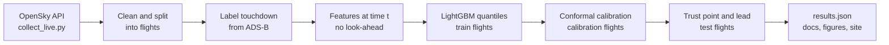

# Glidepath

How early can a ground team at Frankfurt trust a landing time?

Aryan Kumar Singh · MSc student at Berlin School of Business and Innovation, Berlin · [bewithaksingh.com](https://bewithaksingh.com) · [LinkedIn](https://linkedin.com/in/aksingh06) · [GitHub](https://github.com/aksingh1608)

<p>
  
  
  
</p>

> This is a pilot. It uses one evening of live OpenSky data from Frankfurt, 18 October 2026, 17:45 CEST to 03:37 CEST the next morning (9.9 hours). I kept 120 arrivals and held out the last 24 as a test set. The collector is still running, so the next version will use separate days.

> ### On the 24 test flights, the landing time became trustworthy within a 5 minute window a median of 7.2 minutes before touchdown.

A note on the baseline. Baseline B's intervals average 8.2 minutes wide, so they can never fit a 5 minute window. Its zero lead at W = 5 comes from that width, not from a wrong guess. Two fairer checks: at W = 10, where the baseline can qualify, the model's median lead is 7.2 minutes against 1.4, and the baseline is never trusted on 45.8 percent of flights. The interval score, which adds width and a penalty for every miss, is 6.8 minutes for the model and 10.5 for the baseline. The model's own intervals are too narrow on test: they hold the truth 71.1 percent of the time against an 80 percent target. Baseline B holds it 79.3 percent of the time.

[Research note](docs/research_note.md) · [One page summary](docs/summary.md) · [Research plan](docs/research_plan.md) · [Related work](docs/related_work.md)

<p align="center">
  
</p>

## The question

Under A-CDM, the estimated landing time feeds stand planning, ground handling and the next departure. A ramp team needs more than a good estimate on average. It needs to know when the estimate has settled enough to act on.

I predict the time to touchdown with an 80 percent interval and look at how each flight's interval behaves as it gets closer:

* Trust point: the first prediction after which every interval is no wider than W minutes and still contains the real touchdown time.
* Trust lead: the minutes from the trust point to touchdown. A flight that never reaches a trust point gets zero.

I use W = 2, 5 and 10 minutes. W = 5 is the main case.

## Results at a glance

| Measure | Model | Baseline B | Baseline A |
|---|---|---|---|
| Median trust lead at W = 5 min (higher is better) | **7.2 min** | 0.0 min | no interval |
| Median trust lead at W = 10 min (higher is better) | **7.2 min** | 1.4 min | no interval |
| Test flights never trusted at W = 5 min | **0.0%** | 100.0% | no interval |
| Mean absolute error at 50 nm out | **1.6 min** | 2.7 min | 7.5 min |
| Interval score, all test rows (lower is better) | **6.8 min** | 10.5 min | no interval |
| Interval coverage on test (target 80%) | 71.1% | **79.3%** | no interval |
| Mean interval width on test | **3.4 min** | 8.2 min | no interval |

Baseline B's intervals are wider than 5 minutes, so the W = 10 row and the interval score are the like for like comparisons.

### Hypotheses

|  | Hypothesis | Result | Evidence |
|---|---|---|---|
| H1 | Conformal calibration brings coverage within 5 points of 80 percent in every distance band. | **Not supported** | Calibrated coverage (%) by band: 0 to 20 nm 74.9, 20 to 50 nm 66.9, 50 to 100 nm 70.2, over 100 nm 71.7. Uncalibrated: 0 to 20 nm 55.2, 20 to 50 nm 28.4, 50 to 100 nm 25.1, over 100 nm 39.1. Target 80 ± 5 points, bands with at least 50 test rows. |
| H2 | At W = 5 min, the model gives a longer trust lead than baseline B. | **Supported** | Median paired difference in trust lead at W = 5 min, model minus baseline B: 7.2 min, 95% bootstrap interval 4.8 to 7.8 min, 24 flights, Wilcoxon p = 1.19e-07. Baseline B's mean width (8.2 min) is above W, so it cannot qualify at W = 5. At W = 10 the medians are 7.2 and 1.4 min. |
| H3 | Trust lead is shorter in busy traffic than in quiet traffic. | **Not supported** | Median trust lead 5.2 min in the quietest traffic tercile (8 flights) and 6.9 min in the busiest (8 flights). Difference quiet minus busy -1.7 min, 95% interval -14.8 to 2.6. |
| H4 | Flights that hold have a shorter trust lead. | Unclear | 1 test flight with holding, 23 without (minimum for a test: 5). |

H1 and H3 did not hold. I report them as they came out. The full rules are in the [research plan](docs/research_plan.md).

## 1. Trust lead

<p align="center">
  
</p>

Each curve shows the share of test flights trusted at or before a given lead, for each window W. Further right is better. The plot at the top of this page pairs each test flight: blue is the model, orange is baseline B.

<details>
<summary>Trust lead table</summary>

| Method | W (min) | Flights | Median lead (min) | Quartiles (min) | Never trusted (%) |
|---|---|---|---|---|---|
| Model, calibrated | 2 | 24 | 3.0 | 2.2 to 3.8 | 12.5 |
| Model, calibrated | 5 | 24 | 7.2 | 4.3 to 8.4 | 0.0 |
| Model, calibrated | 10 | 24 | 7.2 | 4.3 to 8.4 | 0.0 |
| Model, uncalibrated | 2 | 24 | 1.3 | 0.4 to 2.1 | 16.7 |
| Model, uncalibrated | 5 | 24 | 1.3 | 0.4 to 2.1 | 12.5 |
| Model, uncalibrated | 10 | 24 | 1.3 | 0.4 to 2.1 | 12.5 |
| Baseline B, calibrated | 2 | 24 | 0.0 | 0.0 to 0.0 | 100.0 |
| Baseline B, calibrated | 5 | 24 | 0.0 | 0.0 to 0.0 | 100.0 |
| Baseline B, calibrated | 10 | 24 | 1.4 | 0.0 to 1.8 | 45.8 |

</details>

## 2. Point accuracy

<p align="center">
  
  
</p>

| Distance | Method | Flights | MAE (s) | RMSE (s) | P90 abs error (s) |
|---|---|---|---|---|---|
| 100 nm | Model (P50) | 24 | 113 | 148 | 202 |
| 100 nm | Baseline A | 24 | 562 | 581 | 816 |
| 100 nm | Baseline B (P50) | 24 | 188 | 215 | 326 |
| 50 nm | Model (P50) | 24 | 98 | 132 | 252 |
| 50 nm | Baseline A | 24 | 450 | 475 | 716 |
| 50 nm | Baseline B (P50) | 24 | 164 | 179 | 259 |
| 20 nm | Model (P50) | 24 | 69 | 95 | 156 |
| 20 nm | Baseline A | 24 | 294 | 365 | 660 |
| 20 nm | Baseline B (P50) | 24 | 146 | 225 | 463 |

<details>
<summary>Paired point error per flight, with bootstrap intervals</summary>

| Distance | Versus | Flights | Model minus baseline, mean abs error (min, 95% CI) | Flights where model is closer (%) |
|---|---|---|---|---|
| 100 nm | Baseline A | 24 | -7.5 (-8.2 to -6.7) | 100.0 |
| 100 nm | Baseline B (P50) | 24 | -1.2 (-2.0 to -0.4) | 75.0 |
| 50 nm | Baseline A | 24 | -5.9 (-6.9 to -4.9) | 100.0 |
| 50 nm | Baseline B (P50) | 24 | -1.1 (-1.7 to -0.5) | 79.2 |
| 20 nm | Baseline A | 24 | -3.7 (-5.2 to -2.4) | 100.0 |
| 20 nm | Baseline B (P50) | 24 | -1.3 (-2.5 to -0.2) | 62.5 |

</details>

## 3. Calibrated intervals

<p align="center">
  
  
</p>

**Who wins per flight.** At W = 5 minutes the model gave a longer trust lead than baseline B on 100.0 percent of test flights, a tie on 0.0 percent and a shorter lead on 0.0 percent. The mean gain was 7.9 (6.0 to 10.3) minutes.

**Interval score.** The interval score adds the width of the interval and a penalty for each miss, so lower is better and a narrow interval cannot win by missing. Over all test rows the model scored 6.8 minutes against 10.5 for baseline B, a difference of -3.7 (-6.2 to -0.6) minutes.

**Calibration drift.** The intervals are too narrow on the test flights. Calibration reached 80.2 percent on the calibration flights, which the method guarantees, but only 71.1 percent (95% CI 60.1 to 81.4) on the test flights, which landed later in the evening. On its own training flights the model covers 99.7 percent, so it fits those flights much tighter than new ones. This gap is why H1 fails. Splitting by whole days, once more data is in, is the fix.

<p align="center">
  
  
</p>

<details>
<summary>Coverage and width by band</summary>

| Method | Band | Rows | Flights | Coverage (%) [95% CI] | Mean width (min) |
|---|---|---|---|---|---|
| Model, uncalibrated | 0 to 20 nm | 1251 | 24 | 55.2 [45.6, 64.8] | 1.2 |
| Model, uncalibrated | 20 to 50 nm | 955 | 24 | 28.4 [16.2, 41.6] | 1.2 |
| Model, uncalibrated | 50 to 100 nm | 1051 | 24 | 25.1 [13.8, 37.4] | 1.4 |
| Model, uncalibrated | over 100 nm | 389 | 24 | 39.1 [23.2, 57.5] | 2.3 |
| Model, uncalibrated | all | 3646 | 24 | 37.8 [29.6, 46.6] | 1.4 |
| Model, calibrated | 0 to 20 nm | 1251 | 24 | 74.9 [65.4, 84.5] | 1.8 |
| Model, calibrated | 20 to 50 nm | 955 | 24 | 66.9 [52.3, 81.4] | 3.5 |
| Model, calibrated | 50 to 100 nm | 1051 | 24 | 70.2 [54.4, 84.7] | 4.7 |
| Model, calibrated | over 100 nm | 389 | 24 | 71.7 [51.7, 89.4] | 5.3 |
| Model, calibrated | all | 3646 | 24 | 71.1 [60.1, 81.4] | 3.4 |
| Baseline B, calibrated | 0 to 20 nm | 1251 | 24 | 90.7 [85.9, 95.8] | 9.3 |
| Baseline B, calibrated | 20 to 50 nm | 955 | 24 | 91.5 [86.1, 95.9] | 8.4 |
| Baseline B, calibrated | 50 to 100 nm | 1051 | 24 | 64.1 [46.9, 80.3] | 7.1 |
| Baseline B, calibrated | over 100 nm | 389 | 24 | 53.7 [34.0, 72.8] | 7.1 |
| Baseline B, calibrated | all | 3646 | 24 | 79.3 [71.5, 86.7] | 8.2 |

</details>

<details>
<summary>Interval score and pinball loss by band</summary>

| Band | Flights | Interval score, model (min) | Interval score, baseline B (min) | Difference (95% CI) | Pinball loss difference (95% CI) |
|---|---|---|---|---|---|
| 0 to 20 nm | 24 | 3.6 | 9.9 | -6.4 (-7.6 to -4.9) | -0.36 (-0.49 to -0.22) |
| 20 to 50 nm | 24 | 7.2 | 8.7 | -1.5 (-4.0 to 1.4) | -0.12 (-0.33 to 0.09) |
| 50 to 100 nm | 24 | 8.5 | 11.3 | -2.8 (-7.1 to 2.1) | -0.13 (-0.42 to 0.20) |
| over 100 nm | 24 | 11.8 | 14.7 | -2.9 (-10.7 to 5.9) | -0.19 (-0.68 to 0.32) |
| all | 24 | 6.8 | 10.5 | -3.7 (-6.2 to -0.6) | -0.21 (-0.39 to -0.01) |

</details>

<details>
<summary>Quantile reliability table</summary>

| Method | Nominal quantile | Share of rows below (%) | 95% CI |
|---|---|---|---|
| Model, uncalibrated | 0.1 | 25.8 | 14.9 to 38.4 |
| Model, uncalibrated | 0.5 | 48.5 | 35.2 to 63.2 |
| Model, uncalibrated | 0.9 | 63.6 | 50.1 to 78.0 |
| Model, calibrated | 0.1 | 9.5 | 3.3 to 17.4 |
| Model, calibrated | 0.5 | 48.5 | 35.2 to 63.2 |
| Model, calibrated | 0.9 | 80.6 | 69.2 to 91.1 |
| Baseline B, calibrated | 0.1 | 14.2 | 7.7 to 22.0 |
| Baseline B, calibrated | 0.5 | 65.2 | 53.6 to 76.4 |
| Baseline B, calibrated | 0.9 | 93.5 | 87.2 to 99.0 |

</details>

<details>
<summary>Coverage per split</summary>

| Split | Flights | Calibrated coverage (%) | 95% CI | Mean width (min) |
|---|---|---|---|---|
| Train | 72 | 99.7 | 99.5 to 99.9 | 3.8 |
| Calibration | 24 | 80.2 | 69.2 to 89.5 | 3.5 |
| Test | 24 | 71.1 | 60.1 to 81.4 | 3.4 |

</details>

## 4. What drives the interval

<p align="center">
  
</p>

<details>
<summary>Width attribution table (SHAP)</summary>

| Feature | Mean abs width contribution (min) |
|---|---|
| alt_m | 1.14 |
| distance_nm | 0.68 |
| bearing_sin | 0.58 |
| distance_rank | 0.32 |
| gs_kt | 0.31 |
| local_hour | 0.26 |
| bearing_cos | 0.19 |
| speed_toward_kt | 0.16 |
| d_alt_120 | 0.13 |
| turn_5min_deg | 0.12 |

</details>

<details>
<summary>Ablations at W = 5 min</summary>

| Variant | Coverage (%) [95% CI] | Mean width (min) | Median lead (min) [95% CI] | Never trusted (%) |
|---|---|---|---|---|
| full model | 71.1 [60.1, 81.4] | 3.4 | 7.2 [4.8, 7.8] | 0.0 |
| no traffic features | 73.8 [62.0, 84.8] | 3.7 | 7.6 [6.3, 8.7] | 0.0 |
| no direction feature | 71.4 [60.3, 82.0] | 3.5 | 7.7 [5.8, 10.0] | 0.0 |
| no conformal step | 37.8 [29.6, 46.6] | 1.4 | 1.3 [0.5, 1.9] | 12.5 |
| one global conformal correction | 69.3 [58.2, 80.1] | 3.4 | 9.3 [7.5, 16.9] | 4.2 |

</details>

<details>
<summary>Trust lead by traffic, runway direction and holding at W = 5 min</summary>

| Split | Group | Flights | Median lead (min) | Never trusted (%) |
|---|---|---|---|---|
| Traffic tercile | quiet | 8 | 5.2 | 0.0 |
| Traffic tercile | middle | 8 | 7.5 | 0.0 |
| Traffic tercile | busy | 8 | 6.9 | 0.0 |
| Landing direction | 07 | 22 | 7.2 | 0.0 |
| Landing direction | unk | 2 | 5.8 | 0.0 |
| Holding | false | 23 | 7.1 | 0.0 |
| Holding | true | 1 | 7.7 | 0.0 |

</details>

## 5. Example flights

The band is the calibrated interval minus the true time. The dashed line is the trust point.

<p align="center">
  
</p>
<p align="center">
  
  
</p>

## Data

<p align="center">
  
</p>

<p align="center">
  
</p>

* Source: OpenSky Network state vectors in a box around Frankfurt, polled live.
* Window: 18 October 2026, 17:45 CEST to 03:37 CEST the next morning (9.9 hours). 431659 state vectors from 1944 aircraft.
* Flights: 2852 tracks, 120 arrivals kept, 19574 prediction rows, 5 go-arounds.
* Split: Fewer than 3 local days had 150 or more arrivals, so flights were sorted by touchdown time and split into blocks: first 60.0 percent train, next 20.0 percent calibration, the rest test. Train: 72 flights landing 18 October 2026, 18:03 to 20:29 CEST; Calibration: 24 flights landing 18 October 2026, 20:32 to 21:42 CEST; Test: 24 flights landing 18 October 2026, 21:42 to 23:56 CEST.

<details>
<summary>Why tracks were dropped, and how touchdown was labelled</summary>

| Why a track was dropped | Tracks |
|---|---|
| No touchdown seen (departures, overflights) | 2408 |
| Track gap close to the airport | 64 |
| Too few position reports | 241 |
| Never seen far enough out | 19 |

| How touchdown was labelled | Arrivals |
|---|---|
| Extrapolated from last airborne report to first ground report | 76 |
| Midpoint between last airborne and first ground report | 33 |
| No ground report: extrapolated from last low report | 11 |

</details>

## Method



1. Collect OpenSky state vectors around Frankfurt with `collect_live.py`.
2. Split tracks into flights after gaps over 15 minutes. Keep arrivals seen beyond 30 nm that touch down within 5 nm of the airport.
3. Label touchdown from the first ground report, or extrapolate from the last airborne point when the gap is long or there is no ground report.
4. Build features from data at or before each prediction time: position, speed, altitude changes, turning, recent landing direction and traffic.
5. Train LightGBM quantile models (0.1, 0.5, 0.9) on the train flights.
6. Calibrate with conformalized quantile regression on the calibration flights, per distance band, to 80 percent target coverage.
7. On the test flights, find the trust point for W = 2, 5, 10 minutes and compare with baseline B (quantiles of time to touchdown by 5 nm distance bin and landing direction).

Baselines: Baseline A is distance divided by ground speed, a point estimate. Baseline B is the empirical quantiles of time to touchdown by distance bin and landing direction, calibrated the same way as the model.

Statistics: every interval resamples whole test flights (10000 bootstrap draws), because rows inside a flight are not independent. The paired test is a Wilcoxon signed-rank test.

## Limitations

* One evening of data. The 24 test flights come from the later part of one evening.
* Train, calibration and test are time blocks from the same evening, not separate days.
* OpenSky depends on volunteer receivers, so coverage near the ground at Frankfurt has gaps.
* Touchdown is estimated from ADS-B, not taken from an official landing time. 87 of 120 touchdowns were estimated across a gap in the reports, not seen between two reports under a minute apart. That error can reach 2 minutes, so read the W = 2 results with care.
* The traffic features treat other aircraft as known arrivals, the way a flight plan would.
* Conformal coverage holds on average over rows, not for every single flight.

## Run it yourself

```bash
make install              # create .venv and install packages
make test                 # unit tests
make results-synthetic    # SYNTHETIC TEST run of the full pipeline, no API needed
make status               # what the collector has saved so far
make results              # rebuild everything from the live data in data/raw/live
make docs                 # rebuild README and docs from results/results.json only
make serve                # replay site on your own machine at localhost:8000
```

The collector needs an OpenSky API client in `credentials.json`, which is never committed:

```bash
GLIDEPATH_POLL_SECONDS=30 nohup systemd-inhibit --what=idle:sleep --why=glidepath python3 collect_live.py >> collector.log 2>&1 &
```

## Repository

```
collect_live.py        OpenSky collector, standard library only
run.py                 one command from raw CSVs to results, figures, docs and site data
pipeline/              data, features, splits, models, trust, evaluation, diagnostics, figures, docs
tests/                 leakage, split, trust, conformal and scoring tests
results/               results.json, tables and figures
docs/                  research note, summary, research plan, related work
web/                   static replay site (MapLibre)
```

## Related work

* DFS Aviation Services, Arrival Manager (AMAN). https://dfs-as.aero/download/12107
* FlightAware Foresight. https://flightaware.com/commercial/foresight
* Glina, Jordan and Ishutkina (2012), MIT Lincoln Laboratory: quantile regression forests for landing times at Dallas/Fort Worth. https://www.ll.mit.edu/r-d/publications/tree-based-ensemble-method-prediction-and-uncertainty-quantification-aircraft
* Kim, Yoon and Lee (2025), Probabilistic Multi-Agent Aircraft Landing Time Prediction, arXiv 2512.08281. https://arxiv.org/abs/2512.08281
* Romano, Patterson and Candès (2019), Conformalized Quantile Regression, NeurIPS. https://arxiv.org/abs/1905.03222
* Schäfer et al. (2014), Bringing Up OpenSky, IPSN. https://doi.org/10.1109/IPSN.2014.6846743

More in [docs/related_work.md](docs/related_work.md) and [references.bib](references.bib).

## Data source and citation

Data from [The OpenSky Network](https://opensky-network.org). If you use this work, please cite:

> Matthias Schäfer, Martin Strohmeier, Vincent Lenders, Ivan Martinovic and Matthias Wilhelm. Bringing Up OpenSky: A Large-scale ADS-B Sensor Network for Research. In Proceedings of the 13th IEEE/ACM International Symposium on Information Processing in Sensor Networks (IPSN), pages 83 to 94, April 2014.

## License

MIT, see [LICENSE](LICENSE).

<sub>All numbers in this README come from results/results.json. Run make results to rebuild it from the raw data. Research demo, not for operational use.</sub>
