# How early can a ground team trust a landing time? A pilot study at Frankfurt

Aryan Kumar Singh, Berlin School of Business and Innovation, Berlin. October 2026.

> This is a pilot. It uses one evening of live OpenSky data from Frankfurt, 18 October 2026, 17:45 CEST to 03:37 CEST the next morning (9.9 hours). I kept 120 arrivals and held out the last 24 as a test set. The collector is still running, so the next version will use separate days.

## Abstract

Ground teams at A-CDM airports plan stands and handling around the estimated landing time. They need to know when that estimate can be trusted, not only how accurate it is on average. I study this for arrivals at Frankfurt (EDDF) using open ADS-B data from the OpenSky Network. LightGBM quantile models predict the time to touchdown, and conformalized quantile regression calibrates the interval per distance band to 80 percent target coverage. For each flight I define a trust point: the first prediction after which every interval is no wider than a window W and contains the true touchdown. On 9.9 hours of live data, the 24 held out test flights had a median trust lead of 7.2 minutes at W = 5. An empirical baseline could not qualify at that window because its intervals were wider than 5 minutes; at W = 10 its median lead was 1.4 minutes. The model's test coverage was 71.1 percent, below target, which points to drift within the evening. This is a pilot, and data collection continues.

## 1. Introduction

In Airport Collaborative Decision Making (A-CDM), the estimated landing time (ELDT) feeds the estimated in-block time, stand and gate planning, and the target off-block time of the next departure. The EUROCONTROL A-CDM manual names both the accuracy and the timeliness of ELDT as performance indicators. A ground team needs both at once. An estimate that is right on average but still moves in the last minutes forces late decisions.

I ask how early a ground team at Frankfurt can trust a landing time. I answer with a prediction interval and a trust point for each flight. Earlier work predicts landing time well (for example DFS AMAN, FlightAware Foresight, and research models at Dallas/Fort Worth and Incheon), and some work gives intervals (Glina et al. 2012, Kim, Yoon and Lee 2025). I did not find a study that measures when the interval for one flight becomes both narrow and correct. The full review is in `docs/related_work.md`.

## 2. Data

I polled the OpenSky Network REST API for state vectors around Frankfurt on 18 October 2026, 17:45 CEST to 03:37 CEST the next morning (9.9 hours). This gave 431659 state vectors from 1944 aircraft. I split the tracks into 2852 flights and kept 120 arrivals.

| Why a track was dropped | Tracks |
|---|---|
| No touchdown seen (departures, overflights) | 2408 |
| Track gap close to the airport | 64 |
| Too few position reports | 241 |
| Never seen far enough out | 19 |

| How touchdown was labelled | Arrivals |
|---|---|
| Extrapolated from last airborne report to first ground report | 76 |
| Midpoint between last airborne and first ground report | 33 |
| No ground report: extrapolated from last low report | 11 |

Landing directions: 07 102, unk 16, 25 2.

Fewer than 3 local days had 150 or more arrivals, so flights were sorted by touchdown time and split into blocks: first 60.0 percent train, next 20.0 percent calibration, the rest test. Train: 72 flights landing 18 October 2026, 18:03 to 20:29 CEST; Calibration: 24 flights landing 18 October 2026, 20:32 to 21:42 CEST; Test: 24 flights landing 18 October 2026, 21:42 to 23:56 CEST.

## 3. Method

1. Collect OpenSky state vectors around Frankfurt with `collect_live.py`.
2. Split tracks into flights after gaps over 15 minutes. Keep arrivals seen beyond 30 nm that touch down within 5 nm of the airport.
3. Label touchdown from the first ground report, or extrapolate from the last airborne point when the gap is long or there is no ground report.
4. Build features from data at or before each prediction time: position, speed, altitude changes, turning, recent landing direction and traffic.
5. Train LightGBM quantile models (0.1, 0.5, 0.9) on the train flights.
6. Calibrate with conformalized quantile regression on the calibration flights, per distance band, to 80 percent target coverage.
7. On the test flights, find the trust point for W = 2, 5, 10 minutes and compare with baseline B (quantiles of time to touchdown by 5 nm distance bin and landing direction).

Baselines: Baseline A divides distance by ground speed. Baseline B takes empirical quantiles of time to touchdown in training, by distance bin and recent landing direction, and gets the same conformal correction as the model.

Further statistics: the interval score and the pinball loss are proper scores [gneiting2007strictly], so they reward intervals that are both narrow and correct. I also report paired point error per flight, quantile reliability and coverage per split.

Statistics: every interval comes from 10000 bootstrap resamples of whole test flights, because rows inside a flight are not independent. The paired comparison uses a Wilcoxon signed-rank test.

## 4. Results

On the 24 test flights, the landing time became trustworthy within a 5 minute window a median of 7.2 minutes before touchdown.

A note on the baseline. Baseline B's intervals average 8.2 minutes wide, so they can never fit a 5 minute window. Its zero lead at W = 5 comes from that width, not from a wrong guess. Two fairer checks: at W = 10, where the baseline can qualify, the model's median lead is 7.2 minutes against 1.4, and the baseline is never trusted on 45.8 percent of flights. The interval score, which adds width and a penalty for every miss, is 6.8 minutes for the model and 10.5 for the baseline. The model's own intervals are too narrow on test: they hold the truth 71.1 percent of the time against an 80 percent target. Baseline B holds it 79.3 percent of the time.

| Method | W (min) | Flights | Median lead (min) | Quartiles (min) | Never trusted (%) |
|---|---|---|---|---|---|
| Model, calibrated | 2 | 24 | 3.0 | 2.2 to 3.8 | 12.5 |
| Model, calibrated | 5 | 24 | 7.2 | 4.3 to 8.4 | 0.0 |
| Model, calibrated | 10 | 24 | 7.2 | 4.3 to 8.4 | 0.0 |
| Model, uncalibrated | 2 | 24 | 1.3 | 0.4 to 2.1 | 16.7 |
| Model, uncalibrated | 5 | 24 | 1.3 | 0.4 to 2.1 | 12.5 |
| Model, uncalibrated | 10 | 24 | 1.3 | 0.4 to 2.1 | 12.5 |
| Baseline B, calibrated | 2 | 24 | 0.0 | 0.0 to 0.0 | 100.0 |
| Baseline B, calibrated | 5 | 24 | 0.0 | 0.0 to 0.0 | 100.0 |
| Baseline B, calibrated | 10 | 24 | 1.4 | 0.0 to 1.8 | 45.8 |

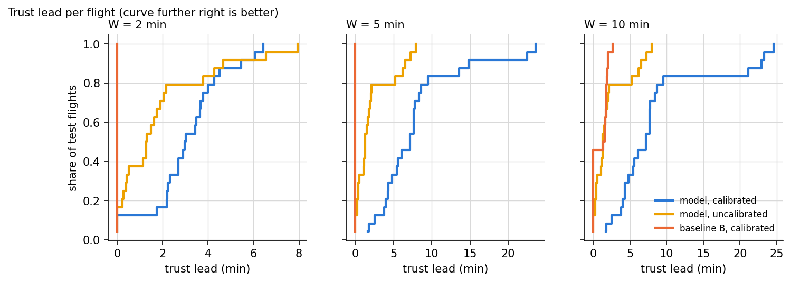

| Method | Band | Rows | Flights | Coverage (%) [95% CI] | Mean width (min) |
|---|---|---|---|---|---|
| Model, uncalibrated | 0 to 20 nm | 1251 | 24 | 55.2 [45.6, 64.8] | 1.2 |
| Model, uncalibrated | 20 to 50 nm | 955 | 24 | 28.4 [16.2, 41.6] | 1.2 |
| Model, uncalibrated | 50 to 100 nm | 1051 | 24 | 25.1 [13.8, 37.4] | 1.4 |
| Model, uncalibrated | over 100 nm | 389 | 24 | 39.1 [23.2, 57.5] | 2.3 |
| Model, uncalibrated | all | 3646 | 24 | 37.8 [29.6, 46.6] | 1.4 |
| Model, calibrated | 0 to 20 nm | 1251 | 24 | 74.9 [65.4, 84.5] | 1.8 |
| Model, calibrated | 20 to 50 nm | 955 | 24 | 66.9 [52.3, 81.4] | 3.5 |
| Model, calibrated | 50 to 100 nm | 1051 | 24 | 70.2 [54.4, 84.7] | 4.7 |
| Model, calibrated | over 100 nm | 389 | 24 | 71.7 [51.7, 89.4] | 5.3 |
| Model, calibrated | all | 3646 | 24 | 71.1 [60.1, 81.4] | 3.4 |
| Baseline B, calibrated | 0 to 20 nm | 1251 | 24 | 90.7 [85.9, 95.8] | 9.3 |
| Baseline B, calibrated | 20 to 50 nm | 955 | 24 | 91.5 [86.1, 95.9] | 8.4 |
| Baseline B, calibrated | 50 to 100 nm | 1051 | 24 | 64.1 [46.9, 80.3] | 7.1 |
| Baseline B, calibrated | over 100 nm | 389 | 24 | 53.7 [34.0, 72.8] | 7.1 |
| Baseline B, calibrated | all | 3646 | 24 | 79.3 [71.5, 86.7] | 8.2 |

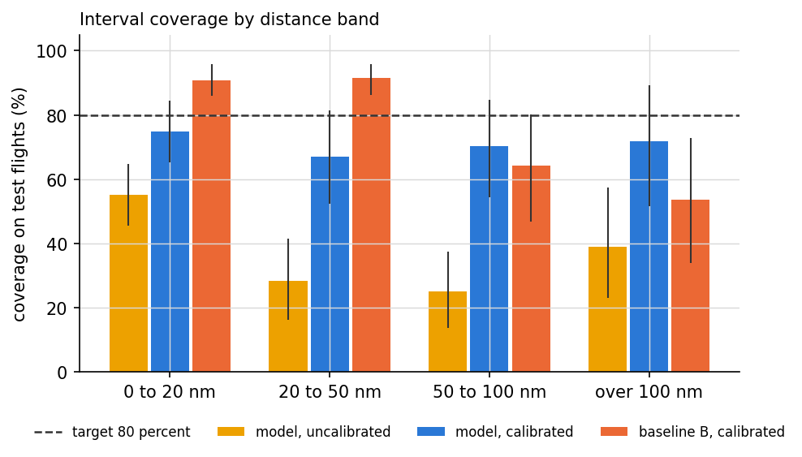

| Distance | Method | Flights | MAE (s) | RMSE (s) | P90 abs error (s) |
|---|---|---|---|---|---|
| 100 nm | Model (P50) | 24 | 113 | 148 | 202 |
| 100 nm | Baseline A | 24 | 562 | 581 | 816 |
| 100 nm | Baseline B (P50) | 24 | 188 | 215 | 326 |
| 50 nm | Model (P50) | 24 | 98 | 132 | 252 |
| 50 nm | Baseline A | 24 | 450 | 475 | 716 |
| 50 nm | Baseline B (P50) | 24 | 164 | 179 | 259 |
| 20 nm | Model (P50) | 24 | 69 | 95 | 156 |
| 20 nm | Baseline A | 24 | 294 | 365 | 660 |
| 20 nm | Baseline B (P50) | 24 | 146 | 225 | 463 |

| Split | Group | Flights | Median lead (min) | Never trusted (%) |
|---|---|---|---|---|
| Traffic tercile | quiet | 8 | 5.2 | 0.0 |
| Traffic tercile | middle | 8 | 7.5 | 0.0 |
| Traffic tercile | busy | 8 | 6.9 | 0.0 |
| Landing direction | 07 | 22 | 7.2 | 0.0 |
| Landing direction | unk | 2 | 5.8 | 0.0 |
| Holding | false | 23 | 7.1 | 0.0 |
| Holding | true | 1 | 7.7 | 0.0 |

| Variant | Coverage (%) [95% CI] | Mean width (min) | Median lead (min) [95% CI] | Never trusted (%) |
|---|---|---|---|---|
| full model | 71.1 [60.1, 81.4] | 3.4 | 7.2 [4.8, 7.8] | 0.0 |
| no traffic features | 73.8 [62.0, 84.8] | 3.7 | 7.6 [6.3, 8.7] | 0.0 |
| no direction feature | 71.4 [60.3, 82.0] | 3.5 | 7.7 [5.8, 10.0] | 0.0 |
| no conformal step | 37.8 [29.6, 46.6] | 1.4 | 1.3 [0.5, 1.9] | 12.5 |
| one global conformal correction | 69.3 [58.2, 80.1] | 3.4 | 9.3 [7.5, 16.9] | 4.2 |

| Feature | Mean abs width contribution (min) |
|---|---|
| alt_m | 1.14 |
| distance_nm | 0.68 |
| bearing_sin | 0.58 |
| distance_rank | 0.32 |
| gs_kt | 0.31 |
| local_hour | 0.26 |
| bearing_cos | 0.19 |
| speed_toward_kt | 0.16 |
| d_alt_120 | 0.13 |
| turn_5min_deg | 0.12 |

Hypotheses:

* H1 not supported. Calibrated coverage (%) by band: 0 to 20 nm 74.9, 20 to 50 nm 66.9, 50 to 100 nm 70.2, over 100 nm 71.7. Uncalibrated: 0 to 20 nm 55.2, 20 to 50 nm 28.4, 50 to 100 nm 25.1, over 100 nm 39.1. Target 80 ± 5 points, bands with at least 50 test rows.
* H2 supported. Median paired difference in trust lead at W = 5 min, model minus baseline B: 7.2 min, 95% bootstrap interval 4.8 to 7.8 min, 24 flights, Wilcoxon p = 1.19e-07. Baseline B's mean width (8.2 min) is above W, so it cannot qualify at W = 5. At W = 10 the medians are 7.2 and 1.4 min.
* H3 not supported. Median trust lead 5.2 min in the quietest traffic tercile (8 flights) and 6.9 min in the busiest (8 flights). Difference quiet minus busy -1.7 min, 95% interval -14.8 to 2.6.
* H4 unclear. 1 test flight with holding, 23 without (minimum for a test: 5).

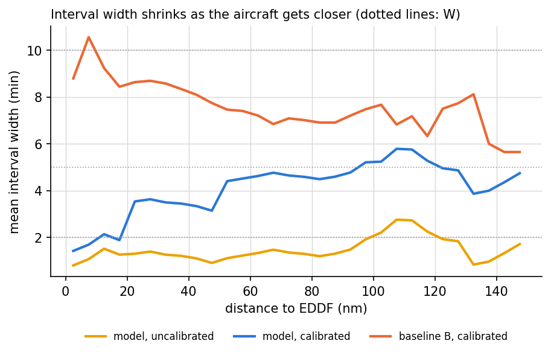

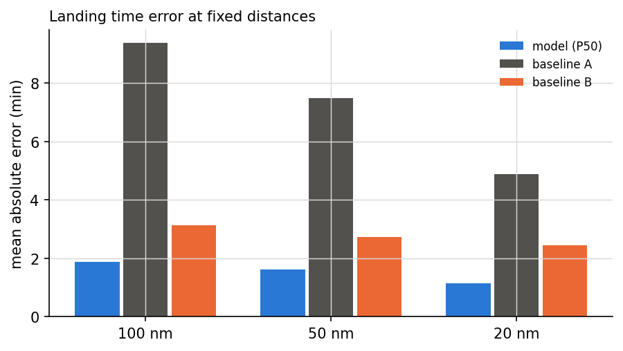

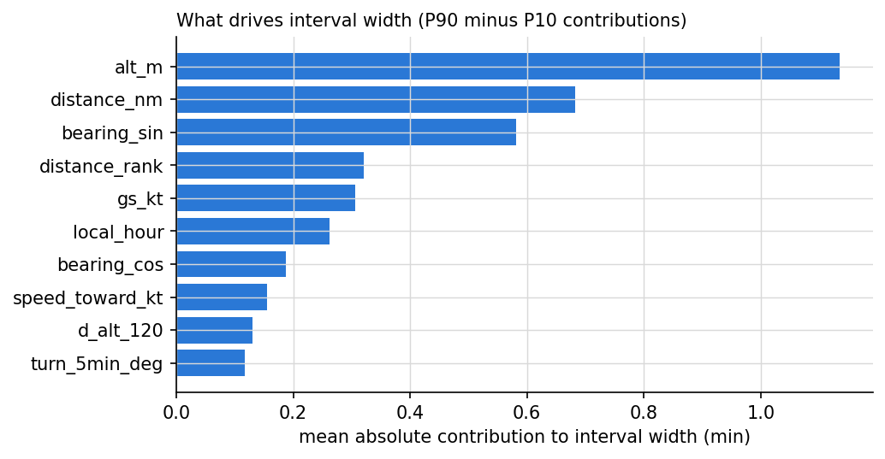

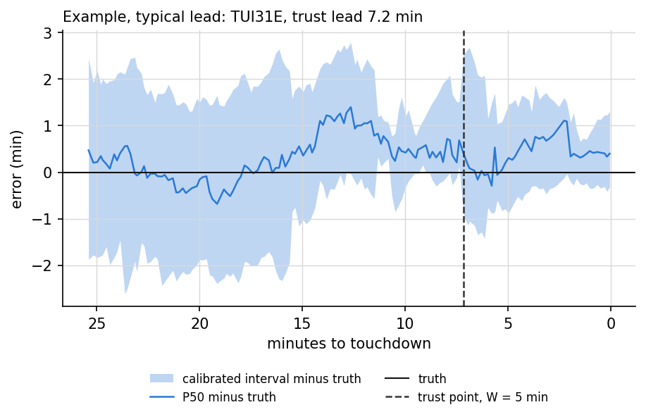
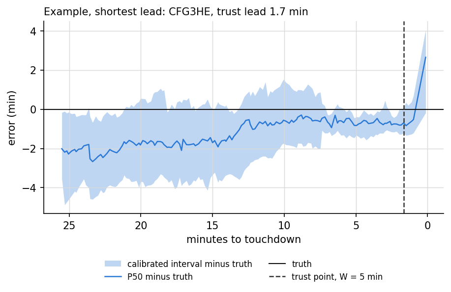
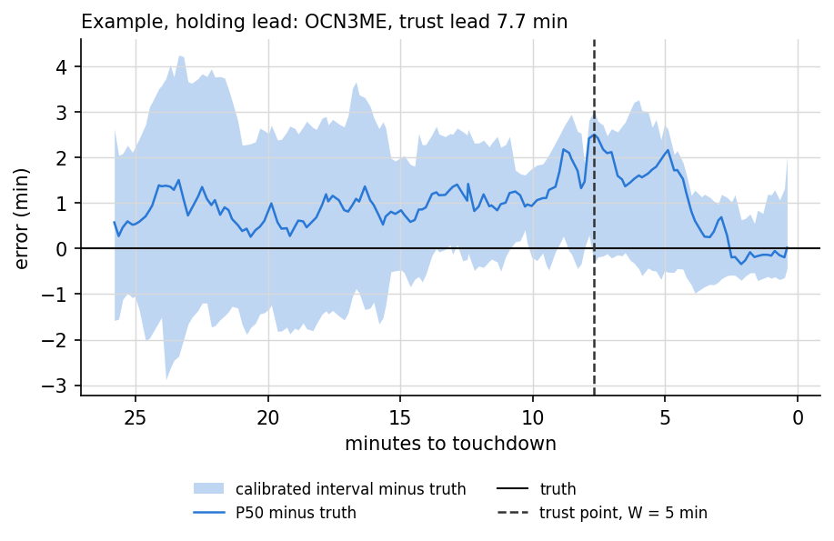

### 4.1 Further statistics

These are exploratory. They explain the hypothesis results and do not change any verdict.

**Who wins per flight.** At W = 5 minutes the model gave a longer trust lead than baseline B on 100.0 percent of test flights, a tie on 0.0 percent and a shorter lead on 0.0 percent. The mean gain was 7.9 (6.0 to 10.3) minutes.

**Interval score.** The interval score adds the width of the interval and a penalty for each miss, so lower is better and a narrow interval cannot win by missing. Over all test rows the model scored 6.8 minutes against 10.5 for baseline B, a difference of -3.7 (-6.2 to -0.6) minutes.

**Calibration drift.** The intervals are too narrow on the test flights. Calibration reached 80.2 percent on the calibration flights, which the method guarantees, but only 71.1 percent (95% CI 60.1 to 81.4) on the test flights, which landed later in the evening. On its own training flights the model covers 99.7 percent, so it fits those flights much tighter than new ones. This gap is why H1 fails. Splitting by whole days, once more data is in, is the fix.

#### Interval score and pinball loss, model minus baseline B (negative favours the model)

| Band | Flights | Interval score, model (min) | Interval score, baseline B (min) | Difference (95% CI) | Pinball loss difference (95% CI) |
|---|---|---|---|---|---|
| 0 to 20 nm | 24 | 3.6 | 9.9 | -6.4 (-7.6 to -4.9) | -0.36 (-0.49 to -0.22) |
| 20 to 50 nm | 24 | 7.2 | 8.7 | -1.5 (-4.0 to 1.4) | -0.12 (-0.33 to 0.09) |
| 50 to 100 nm | 24 | 8.5 | 11.3 | -2.8 (-7.1 to 2.1) | -0.13 (-0.42 to 0.20) |
| over 100 nm | 24 | 11.8 | 14.7 | -2.9 (-10.7 to 5.9) | -0.19 (-0.68 to 0.32) |
| all | 24 | 6.8 | 10.5 | -3.7 (-6.2 to -0.6) | -0.21 (-0.39 to -0.01) |

#### Paired point error at fixed distances

| Distance | Versus | Flights | Model minus baseline, mean abs error (min, 95% CI) | Flights where model is closer (%) |
|---|---|---|---|---|
| 100 nm | Baseline A | 24 | -7.5 (-8.2 to -6.7) | 100.0 |
| 100 nm | Baseline B (P50) | 24 | -1.2 (-2.0 to -0.4) | 75.0 |
| 50 nm | Baseline A | 24 | -5.9 (-6.9 to -4.9) | 100.0 |
| 50 nm | Baseline B (P50) | 24 | -1.1 (-1.7 to -0.5) | 79.2 |
| 20 nm | Baseline A | 24 | -3.7 (-5.2 to -2.4) | 100.0 |
| 20 nm | Baseline B (P50) | 24 | -1.3 (-2.5 to -0.2) | 62.5 |

#### Quantile reliability

| Method | Nominal quantile | Share of rows below (%) | 95% CI |
|---|---|---|---|
| Model, uncalibrated | 0.1 | 25.8 | 14.9 to 38.4 |
| Model, uncalibrated | 0.5 | 48.5 | 35.2 to 63.2 |
| Model, uncalibrated | 0.9 | 63.6 | 50.1 to 78.0 |
| Model, calibrated | 0.1 | 9.5 | 3.3 to 17.4 |
| Model, calibrated | 0.5 | 48.5 | 35.2 to 63.2 |
| Model, calibrated | 0.9 | 80.6 | 69.2 to 91.1 |
| Baseline B, calibrated | 0.1 | 14.2 | 7.7 to 22.0 |
| Baseline B, calibrated | 0.5 | 65.2 | 53.6 to 76.4 |
| Baseline B, calibrated | 0.9 | 93.5 | 87.2 to 99.0 |

#### Calibration drift across the evening

| Split | Flights | Calibrated coverage (%) | 95% CI | Mean width (min) |
|---|---|---|---|---|
| Train | 72 | 99.7 | 99.5 to 99.9 | 3.8 |
| Calibration | 24 | 80.2 | 69.2 to 89.5 | 3.5 |
| Test | 24 | 71.1 | 60.1 to 81.4 | 3.4 |

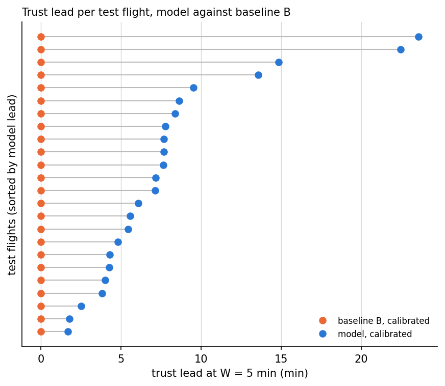

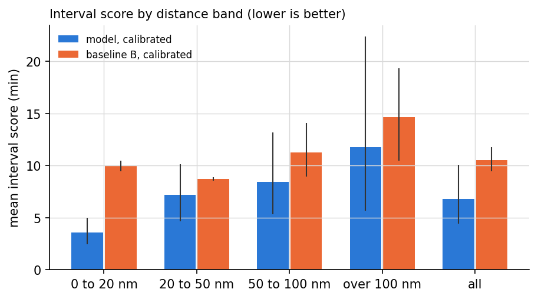

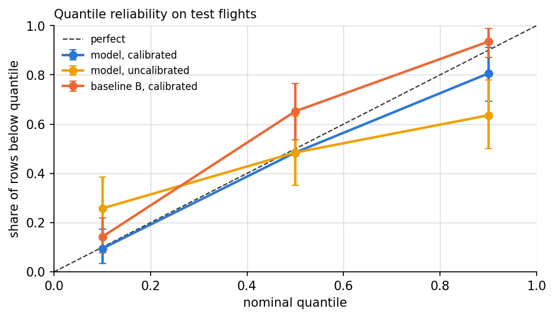

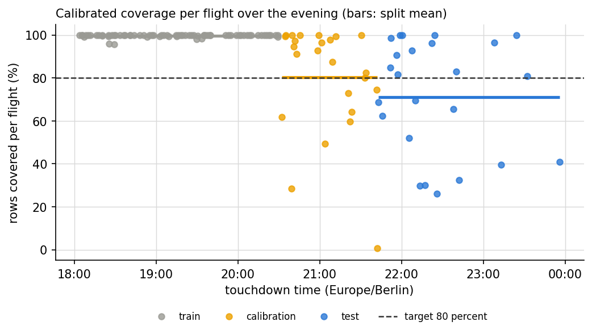

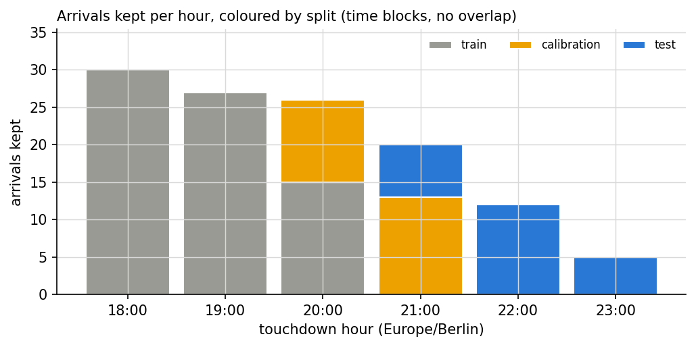

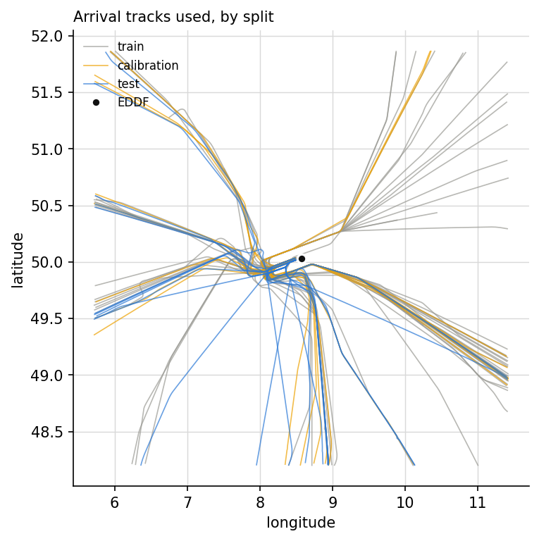

## 5. Discussion

At W = 5 minutes the model gave a longer trust lead than baseline B, and the bootstrap interval of the paired difference lies above zero.

At W = 10, where baseline B can qualify, the model's median lead is 7.2 minutes against 1.4. The interval score, which adds width and a penalty for every miss, is 6.8 minutes for the model and 10.5 for the baseline.

0.0 percent of test flights were never trusted by the calibrated model at W = 5 minutes, against 100.0 percent for baseline B. The trust point is strict. One late miss resets it, and an interval built to miss a share of rows will often miss close to touchdown.

H1 is not supported. Calibration on one block of the evening does not guarantee coverage on the next block when traffic changes.

H3 and H4 rest on small groups in a pilot of one evening. Read their results (not supported and unclear) as a first look.

## 6. Limitations

* One evening of data. The 24 test flights come from the later part of one evening.
* Train, calibration and test are time blocks from the same evening, not separate days.
* OpenSky depends on volunteer receivers, so coverage near the ground at Frankfurt has gaps.
* Touchdown is estimated from ADS-B, not taken from an official landing time. 87 of 120 touchdowns were estimated across a gap in the reports, not seen between two reports under a minute apart. That error can reach 2 minutes, so read the W = 2 results with care.
* The traffic features treat other aircraft as known arrivals, the way a flight plan would.
* Conformal coverage holds on average over rows, not for every single flight.

## 7. Future work

* Run the collector over many days and split by day, as the pipeline already does once enough days exist.
* Use the OpenSky Trino history to train and test over months.
* Add weather, for example METAR wind, which drives runway choice and approach speed.
* Regularise the quantile model more strongly. Train coverage near one hundred percent shows it fits its own flights too tightly. Any such change must be chosen on train and calibration flights only, never on test.
* Recalibrate on a rolling window of recent flights to follow drift through the evening.
* Repeat the study at more airports.

## References

See `references.bib`.

Research demo, not for operational use.
